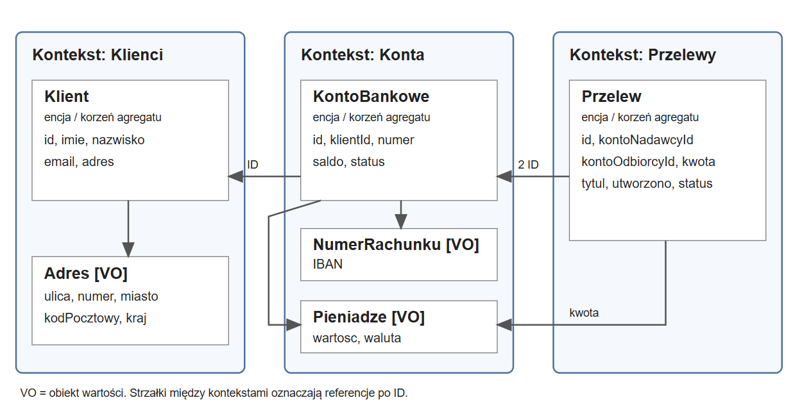

# Zadanie 1 – model aplikacji bankowej

Wybrałem fragment bankowości związany z kontami i przelewami. Model ma trzy konteksty: Klienci, Konta i Przelewy. Każdy z nich przechowuje swoje dane, a do pozostałych odwołuje się przez ID. Zakładam przelewy tylko w PLN, między kontami w tym samym banku.

## Podział modelu

| Kontekst | Agregat i jego korzeń | Obiekty wartości |
| --- | --- | --- |
| Klienci | Klient | Adres |
| Konta | KontoBankowe | NumerRachunku, Pieniadze |
| Przelewy | Przelew | Pieniadze jako kwota przelewu |

Klient, KontoBankowe i Przelew to encje z własnym ID typu UUID. Obiekty wartości nie mają ID i są porównywane po zawartości.

## Dane i ograniczenia

| Element | Atrybuty i zasady |
| --- | --- |
| Klient | `id`, `imie`, `nazwisko`, `email`, `adres`. Imię i nazwisko: 1–50 znaków, litery Unicode, spacja, apostrof lub myślnik. Email: poprawny format, do 254 znaków, bez znaków sterujących. |
| Adres | `ulica` (1–100 znaków), `numer` (1–10), `miasto` (1–60), `kodPocztowy` w formacie NN-NNN, `kraj: PL`. Wszystkie pola wymagane, bez HTML i znaków sterujących. |
| KontoBankowe | `id`, `klientId`, `numer`, `saldo`, `status`: AKTYWNE, ZABLOKOWANE lub ZAMKNIETE. Jeden właściciel na konto; klient może mieć kilka kont. Saldo nie może być ujemne. |
| NumerRachunku | Unikalny polski IBAN: PL i 26 cyfr, bez spacji. Sprawdzana także suma kontrolna modulo 97. |
| Pieniadze | `wartosc: Decimal`, do dwóch miejsc po przecinku, `waluta: PLN`. Saldo może być zerowe. Kwota przelewu: od 0,01 do 10 000,00 PLN. |
| Przelew | `id`, `kontoNadawcyId`, `kontoOdbiorcyId`, `kwota`, `tytul`, `utworzono`, `status`. Tytuł: 1–140 znaków, bez HTML i znaków sterujących. Data i czas w UTC. Status: ZLECONY, WYKONANY lub ODRZUCONY. |

## Zasady działania

1. Konto można otworzyć tylko dla istniejącego klienta.
2. Przelew może zlecić zalogowany właściciel konta nadawcy. Backend sprawdza właściciela na podstawie sesji.
3. Oba konta muszą istnieć, być aktywne i mieć różne ID. Nadawca musi mieć wystarczające środki.
4. Zakładam jedną aplikację i wspólną bazę. Obciążenie nadawcy, uznanie odbiorcy i zapis statusu odbywają się w jednej transakcji z blokadą kont. W razie błędu zmiany są cofane.
5. Ten sam przelew nie może zostać wykonany ponownie. Kolejne żądanie z tym samym ID zwraca zapisany wynik.
6. Dane są sprawdzane na backendzie przy tworzeniu i zmianie obiektów. Tekst jest przycinany ze skrajnych spacji przed sprawdzeniem długości. Sam mechanizm logowania jest poza zakresem modelu.
