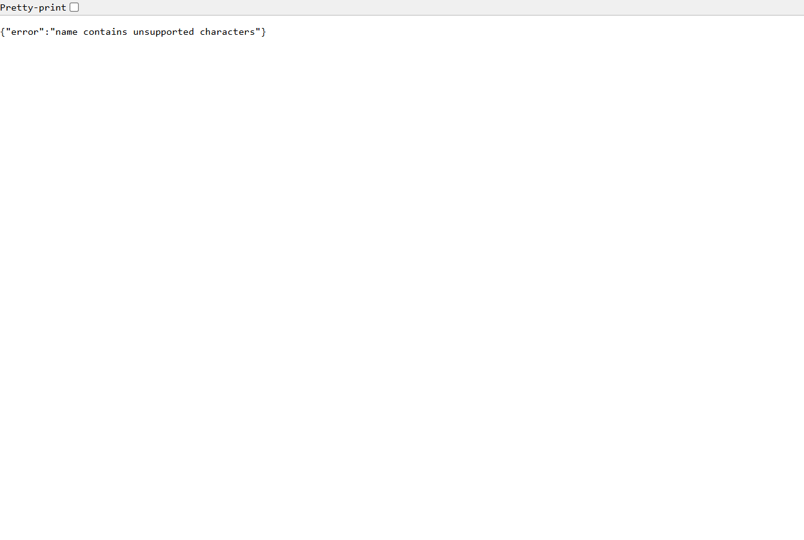
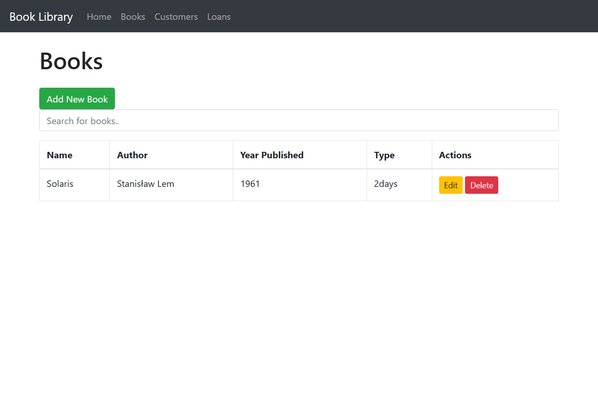

# Walidacja danych książek i czytelników – poprawka stored XSS

## Znaleziona podatność

W aplikacji Python/Flask znalazłem stored XSS w polach `Book.name`, `Book.author`, `Customer.name` i `Customer.city`. Konstruktory przyjmowały dowolny tekst, który był zapisywany w SQLite. Szablony `books.html` i `customers.html` używają filtra `safe`, więc zapisany HTML mógł wykonać JavaScript przy otwieraniu listy, również przez inną osobę.

## Odtworzenie przed poprawką

1. Uruchomić wersję z gałęzi `main`, przed połączeniem tego PR:

   ```shell
   cd Python/Flask_Book_Library
   docker build -t task1-python-before .
   docker run --name task1-before -p 127.0.0.1:5000:5000 task1-python-before
   ```

2. Otworzyć `http://localhost:5000/books/` i formularz **Add New Book**.
3. W polu Name wpisać ``, Author: `Test XSS`, Year: `2024`, Type: `2 Days`.
4. Dodać książkę i ponownie otworzyć listę. Nad paskiem nawigacji pojawia się napis `XSS`, wstawiony przez wykonany JavaScript. W bazie pozostaje cały payload, więc efekt powtarza się po odświeżeniu. Sprawdziłem też wariant `<script>alert("XSS")</script>`, który wyświetla alert.

Screen z działającej, niepoprawionej aplikacji:


## Wprowadzona poprawka i założenia

- Wspólny `validate_text` przyjmuje tekst o długości 1–64 po `strip()`. Dopuszcza litery Unicode, cyfry, spację oraz znaki `.,'’"-():!?/`. Odrzuca między innymi `<`, `>`, `&`, znaki sterujące, pusty tekst i wartości innego typu.
- W modelach `Book` i `Customer` użyłem `@validates`. Sprawdzenie działa podczas tworzenia obiektu i podczas przypisania nowej wartości przy edycji.
- Widoki przechwytują `ValueError`, wycofują transakcję i zwracają JSON z błędem oraz HTTP 400. Uzupełniłem też sprawdzenie obecności wymaganych danych.
- Walidacja nie polega na usuwaniu słowa `script` ani na zmianie wyświetlania. Szablony pozostały bez zmian, zgodnie z wymaganiem zadania.

To celowo ograniczony format zwykłego tekstu; np. tytuł z `&` zostanie odrzucony. Poprawka blokuje nowe dane w tych czterech polach, ale nie czyści rekordów zapisanych wcześniej. Przed ponownym użyciem starej bazy trzeba usunąć testowe wpisy XSS. W rzeczywistym wdrożeniu dodatkowo zrezygnowałbym z `safe` przy zwykłych tekstach.

## Sprawdzenie

```shell
cd Python/Flask_Book_Library
docker build -t task1-python .
docker run --rm task1-python python -m unittest discover -s tests -v
docker run --name task1-after -p 127.0.0.1:5001:5000 task1-python
```

Wynik: **10 testów OK**. Testy obejmują prawidłowy tekst, polskie litery, granice długości, niewłaściwe typy, kilka payloadów XSS, tworzenie modeli i przypisanie do pól oraz żądania dodawania i edycji. Testy HTTP zastępują commit przez flush i wycofują dane po teście.

W przeglądarce sprawdziłem dodanie książki `Solaris` oraz czytelnika `Jan Kowalski` z miasta `Łódź`. Próba XSS w formularzu została odrzucona kodem 400. Sprawdziłem także, że błędna edycja autora/miasta wycofuje wcześniejszą zmianę nazwy w tym samym żądaniu.




