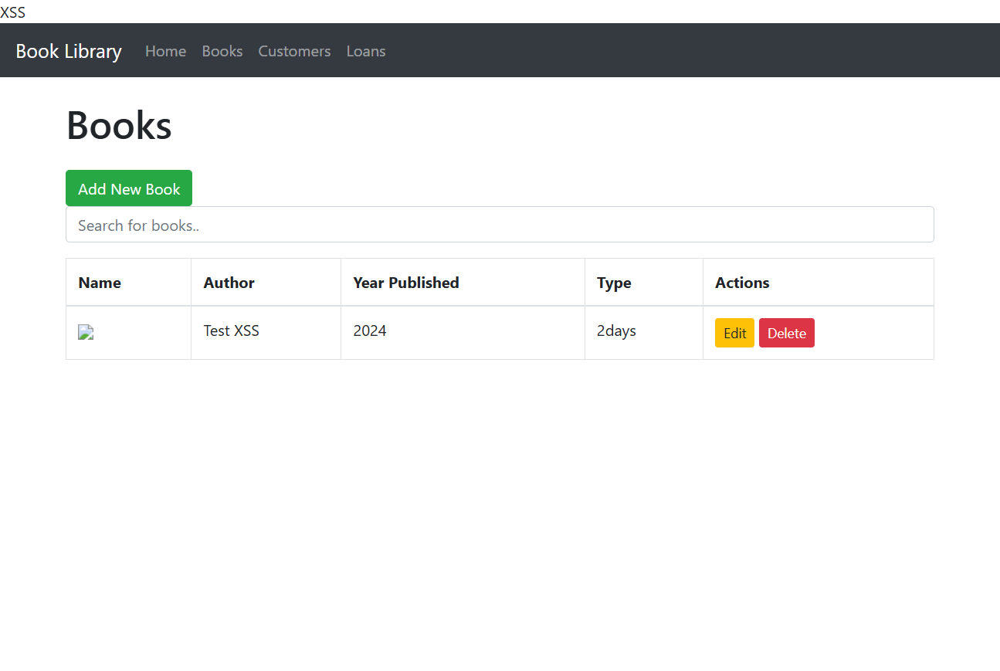

## Błąd

W aplikacji Python znalazłem stored XSS w nazwie i autorze książki oraz w imieniu i mieście czytelnika. Dane trafiały do bazy bez walidacji, a filtr `safe` w szablonach pozwalał wykonać zapisany JavaScript.

## Jak odtworzyć

Na wersji przed poprawką (gałąź `main`):

1. Otworzyć `http://localhost:5000/books/` i kliknąć **Add New Book**.
2. W Name wpisać ``, w Author: `Test XSS`, Year: `2024`, Type: `2 Days`.
3. Dodać książkę i odświeżyć stronę. Nad menu pojawia się napis XSS, dodany przez zapisany skrypt.



## Poprawka

Dodałem wspólny walidator i podłączyłem go do modeli `Book` i `Customer` przez `@validates`. Sprawdza dane przy tworzeniu i edycji: tekst ma mieć 1–64 znaki po usunięciu skrajnych spacji. Dozwolone są litery Unicode, cyfry, spacje i znaki `.,'’"-():!?/`. HTML i pozostałe znaki są odrzucane.

Przy błędzie aplikacja cofa zmiany i zwraca HTTP 400. Walidacja jest na backendzie. Stare wpisy XSS trzeba usunąć osobno.

## Testy

Dodałem testy poprawnych i błędnych danych, tworzenia obiektów oraz edycji. Wszystkie 10 testów przechodzi:

```shell
docker run --rm task1-python python -m unittest discover -s tests -v
```

Sprawdziłem też formularz w przeglądarce: zwykła książka się zapisuje, a próba XSS zwraca 400.
